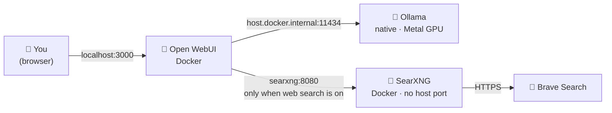

<div align="center">

# 🔒 Private AI Chat

**Your own uncensored AI chat, running on your Mac.**
<br/>
Ollama + Open WebUI + SearXNG, set up for privacy and tuned for small models.

<br/>

[](#requirements)
[](https://ollama.com)
[](https://github.com/open-webui/open-webui)
[](https://github.com/searxng/searxng)
[](https://www.docker.com/products/docker-desktop/)
[](#why)
[](LICENSE)

<br/>

🧠 Local LLM &nbsp;·&nbsp; 🔓 Uncensored &nbsp;·&nbsp; 🔎 Opt-in web search &nbsp;·&nbsp; 🚫 No telemetry &nbsp;·&nbsp; 🏠 Localhost only &nbsp;·&nbsp; ⚡ Fast on 16 GB

</div>

---

<a id="why"></a>
## ✨ Why

Most "local" AI setups still leak: telemetry, update checks, model hubs, cloud fallbacks, or search APIs that tie queries to an account. This repo wires together [Ollama](https://ollama.com), [Open WebUI](https://github.com/open-webui/open-webui) and [SearXNG](https://github.com/searxng/searxng) so that:

| | |
|---|---|
| 🧠 **Your chats stay local** | The model runs in Ollama on your Mac; conversations live in `./data`. With web search off, nothing leaves your machine. |
| 🔓 **Uncensored by default** | Ships with an uncensored model ([`jaahas/qwen3.5-uncensored:4b`](https://ollama.com/jaahas/qwen3.5-uncensored)): no corporate guardrails, no lectures, far fewer refusals. It answers what you ask, so what you do with it is on you. Prefer a filtered model? [Swap it](#using-another-model). |
| 🔎 **Search leaks as little as possible** | Web search is opt-in per chat and goes through your own SearXNG to **Brave Search only**, without cookies, a profile or an account. One provider per query, never Google. It is still web search, though — see [Privacy](#privacy). |
| 🚫 **Nothing phones home** | Telemetry off, OpenAI connection and community sharing disabled, Hugging Face offline. |
| 🏠 **Not on your network** | Open WebUI and Ollama listen on `127.0.0.1` only. SearXNG has no host port at all. |
| ⚡ **Actually usable on a small model** | A tuned preset makes a 4B reasoning model answer in seconds instead of minutes, with web search that really runs. |

## 🗺️ How it works



| Component | Role |
|---|---|
| 🧠 [Ollama](https://ollama.com) | LLM runtime, native on Apple Silicon (Metal) |
| 🤖 [`jaahas/qwen3.5-uncensored:4b`](https://ollama.com/jaahas/qwen3.5-uncensored) | Default model: uncensored Qwen 3.5, 4B, reasoning ([use another one](#using-another-model)) |
| 💬 [Open WebUI](https://github.com/open-webui/open-webui) | Chat interface (Docker, pinned `v0.12.4`) |
| 🔎 [SearXNG](https://github.com/searxng/searxng) | Local search proxy to Brave Search only (Docker, pinned) |
| 📚 [`multilingual-e5-small`](https://huggingface.co/intfloat/multilingual-e5-small) | Picks the relevant parts of fetched pages, works for non-English pages too (local, CPU) |

<a id="requirements"></a>
## 📋 Requirements

- 🍎 **macOS on Apple Silicon** (tested on an M1 with 16 GB). The setup relies on Homebrew, BSD `sed`, and Docker Desktop for Mac forwarding `host.docker.internal` to the host's localhost. Linux and Windows need changes, see [Platform notes](#platform-notes).
- 🐳 [Docker Desktop](https://www.docker.com/products/docker-desktop/)
- 🍺 [Homebrew](https://brew.sh)
- 💾 ~8 GB of free RAM while chatting (model ~3.9 GB, Open WebUI ~1.2 GB, plus Docker's VM)

## 📦 Install (once)

Make sure **Homebrew** and **Docker Desktop** are installed and Docker is running, then:

```bash
git clone https://github.com/<you>/private-ai-chat.git
cd private-ai-chat
make setup
```

`make setup` does everything that can be automated and is safe to re-run (it skips what is already done):

| Step | What happens | Size |
|---|---|---|
| 1️⃣ | Checks Homebrew and Docker | |
| 2️⃣ | Installs Ollama with Homebrew and starts it as a background service (localhost only) | |
| 3️⃣ | Pulls the chat model `jaahas/qwen3.5-uncensored:4b` | ~3.5 GB |
| 4️⃣ | Creates `.env` with random secrets | |
| 5️⃣ | Downloads the embedding model from Hugging Face (only the files it needs) | ~0.5 GB |
| 6️⃣ | Pulls the Docker images and starts Open WebUI + SearXNG | ~6 GB |

Then finish in the browser, once (about two minutes):

1. 👤 Open **http://localhost:3000** and create your account. The first account becomes the admin; it only exists on your machine.
2. ⚙️ Create the **`4b-fast`** model preset: [docs/open-webui-setup.md](docs/open-webui-setup.md), step 1. Optionally also **`4b-think`** (step 1b).

Everything else is pre-configured by `docker-compose.yml`. 🎉

## ▶️ Daily use

```bash
make start   # ▶️  start Ollama (if needed) + containers, then open http://localhost:3000
make stop    # ⏹️  stop containers + unload the model from RAM
```

- 💬 New chats open with **`4b-fast`** and web search on. A **"Retrieved N sources"** line above an answer means the search ran.
- 🤔 For harder questions pick **`4b-think`**: same model with reasoning on. Slower (can take minutes), but more careful.
- ⚠️ Don't chat with the bare base model in the model picker: without the preset settings web search doesn't work.
- 🔕 Turn the globe icon off and the chat is fully local: nothing is sent anywhere. With it on, Brave and the result sites see your IP ([Privacy](#privacy)).

> [!TIP]
> The model only takes RAM while in use, and Ollama unloads it by itself after 5 minutes idle. To free everything, run `make stop` and quit Docker Desktop. Without `make stop`, the containers come back on their own next time Docker starts.

## 🧹 Clean up

> [!WARNING]
> Close all Open WebUI browser tabs first: a tab with a stale session retries in a tight loop until it is closed or reloaded. Both commands below ask you to type `yes` before deleting anything.

| Command | Removes | Keeps |
|---|---|---|
| `make stop` | Running containers, model from RAM | Everything on disk |
| `make clean` | `./data`: all chats, your account, settings, embedding model | Docker images, the Ollama model, `.env`. Start over with `make setup` |
| `make uninstall` | Containers, Docker images, `./data`, `.env`, the Ollama model | Ollama itself and this folder |

To remove Ollama too: `brew services stop ollama && brew uninstall ollama` (and `rm -rf ~/.ollama` for its leftover keys and history). Then delete this folder.

<details>
<summary>🛠️ <b>All make commands</b></summary>

```bash
make up            # start all containers (creates .env if missing)
make env           # create .env with random secrets (no-op if it exists)
make down          # stop all containers
make restart       # restart all containers
make logs          # follow logs (all containers)
make logs-webui    # follow logs (Open WebUI only)
make logs-searxng  # follow logs (SearXNG only)
make status        # container status + resource usage
make help          # show all available targets

make ollama-start              # start Ollama in the background (if not using the brew service)
make ollama-stop               # pkill Ollama (use `brew services stop ollama` to keep it off)
make ollama-list               # list downloaded models
make ollama-pull               # pull the model (OLLAMA_MODEL, default jaahas/qwen3.5-uncensored:4b)
make ollama-rm MODEL=<name>    # remove a model
make ollama-ps                 # show models loaded in RAM
make ollama-status             # check if Ollama is running

make setup         # one-time install (safe to re-run)
make start         # daily start
make stop          # daily stop
make clean         # ⚠️ delete ./data (chats, account, settings), asks first
make uninstall     # ⚠️ remove containers, images, data, .env and the model, asks first
```

</details>

<a id="privacy"></a>
## 🛡️ Privacy

This is **not** an anonymity tool. Think of it as two modes:

### 🔕 Web search off — fully local

The prompt, the model, the answer and the history all stay on your Mac. Nothing is sent anywhere: no telemetry, no cloud model, no account.

### 🌐 Web search on — private-ish, not anonymous

Web search means talking to the internet, and that always leaks something:

- 🦁 **Brave sees your search queries and your IP address.** SearXNG strips cookies and browser fingerprinting, but it can't hide where the request comes from. The queries are generated from your question, so they reveal what you are asking about.
- 🌍 **The sites in the results see your IP too.** Open WebUI downloads the top results to read them, just like you visiting those pages.
- 🔐 **Use a VPN** if that matters to you. It hides your IP from Brave and from those sites (the VPN provider then sees the traffic instead, so pick one you trust). Tor is stronger but much slower, and search engines often block it.
- 🧭 If a question is sensitive, turn the globe icon off for that chat.

### 📋 Details

| | What happens |
|---|---|
| 🧠 Chat | Runs in Ollama on your Mac. History is stored in `./data/open-webui/webui.db` (not encrypted; FileVault protects it at rest). |
| 🔎 Web search | Only when the globe icon is on. Query → your SearXNG → **Brave Search**. No cookies, no profile, no other engines, but your IP is visible. |
| 🌐 Result pages | Fetched directly by Open WebUI; the sites see your IP. |
| 📚 Embeddings | `multilingual-e5-small`, runs locally on CPU. Downloaded once by `make setup`; Open WebUI always runs with Hugging Face offline. |
| 🚫 Telemetry | Off. OpenAI connection and community sharing disabled. |
| 🔔 Update check | Open WebUI asks `api.github.com` for the latest release tag to show the "new version" banner. No chat data is sent; GitHub sees your IP. Set `ENABLE_VERSION_UPDATE_CHECK=false` in `docker-compose.yml` to turn it off. |
| 🏠 Network | Open WebUI on `127.0.0.1:3000`, Ollama on `127.0.0.1:11434`, SearXNG without a host port. Nothing listens on your LAN. |
| 📥 Downloads | Docker images, the Ollama model and the embedding model are downloaded once during setup. |

> [!NOTE]
> Brave rate-limits an IP after many searches in a short time (e.g. heavy testing). SearXNG then pauses Brave for up to an hour and web search returns no results until then. Normal use doesn't hit the limit.

## 🤔 Why the preset matters

With Open WebUI defaults, a small reasoning model hangs for minutes and web search silently does nothing:

- 🐢 Open WebUI asks the model to "think" before every background task (search query, chat title). Measured on the 4B model: **~100 s with thinking vs ~3 s without**, just to write a search query.
- 🔧 It hands web search to the model as a tool, and a 4B model never calls it.

The `4b-fast` preset turns thinking off, uses **Legacy** function calling (Open WebUI searches first and pastes the results into the prompt), and raises the context to 16k tokens. Details and measurements: [docs/open-webui-setup.md](docs/open-webui-setup.md).

<a id="using-another-model"></a>
## 🔁 Using another model

1. Pull it: `make ollama-pull OLLAMA_MODEL=<name>` (or change `OLLAMA_MODEL` in the Makefile to make it the default for `make ollama-pull` and `make stop`).
2. Create the preset as in [docs/open-webui-setup.md](docs/open-webui-setup.md) with your model as the base model. `4b-fast` is only a name; if you choose another one, change `TASK_MODEL` and `DEFAULT_MODELS` in `docker-compose.yml` to match (they only apply to a fresh `./data`; on an existing one set them in the UI).
3. Non-reasoning models don't need the `think` setting, but Legacy function calling still helps small models with web search.

<details>
<summary>⚙️ <b>Configuration files</b></summary>

| File | What it holds |
|---|---|
| `docker-compose.yml` | Pinned images, localhost-only ports, Open WebUI settings pre-seeded on a fresh database (web search, privacy, task/default model, embedding model) |
| `config/searxng/settings.yml` | SearXNG overrides: JSON format, Brave only, metrics off |
| `.env` | Random secrets (`SEARXNG_SECRET`, `WEBUI_SECRET_KEY`) generated by `make env`. Not versioned; template in `.env.example` |
| `data/` | Runtime data: Open WebUI database, embedding model cache. Not versioned |

</details>

<details>
<summary>⬆️ <b>Upgrading</b></summary>

Images are pinned to tested versions in `docker-compose.yml`. To upgrade:

1. Change the tags (Open WebUI: [releases](https://github.com/open-webui/open-webui/releases); SearXNG: [Docker Hub tags](https://hub.docker.com/r/searxng/searxng/tags)).
2. Check the Open WebUI release notes for renamed environment variables. Older releases used `ENABLE_RAG_WEB_SEARCH` / `RAG_WEB_SEARCH_ENGINE`; current ones ignore them, which silently disables web search on a fresh install.
3. `make up`, then run the checks in [docs/open-webui-setup.md](docs/open-webui-setup.md#verify).

</details>

<a id="platform-notes"></a>
<details>
<summary>🐧 <b>Platform notes (Linux, Windows)</b></summary>

- **Linux:** replace `sed -i ''` with `sed -i` in the Makefile, install Ollama with the official script, and make sure containers can reach it: either run Ollama with `OLLAMA_HOST` on the Docker bridge address, or put Open WebUI on the host network. Do not expose Ollama on `0.0.0.0` on an untrusted network.
- **Windows:** use WSL2 and follow the Linux notes.

</details>

<details>
<summary>🩺 <b>Troubleshooting</b></summary>

**Ollama connection error in Open WebUI**
```bash
curl http://localhost:11434   # should return "Ollama is running"
brew services start ollama    # if not running
```

**Web search returns 403**
```bash
# Check that JSON format is enabled in the SearXNG config
grep -A3 "formats" config/searxng/settings.yml
# After editing it, restart SearXNG:
docker compose restart searxng
```

**Verify SearXNG is reachable from Open WebUI**
```bash
docker exec open-webui python -c "import urllib.request; print(urllib.request.urlopen('http://searxng:8080/search?q=test&format=json').status)"
```

More symptoms and fixes: [docs/open-webui-setup.md](docs/open-webui-setup.md#troubleshooting).

</details>

## 📄 License

[MIT](LICENSE). Open WebUI, SearXNG, Ollama and the model have their own licenses.

<div align="center">
<sub>Your conversations stay yours. Your searches are as private as web search allows. 🔒</sub>
</div>
